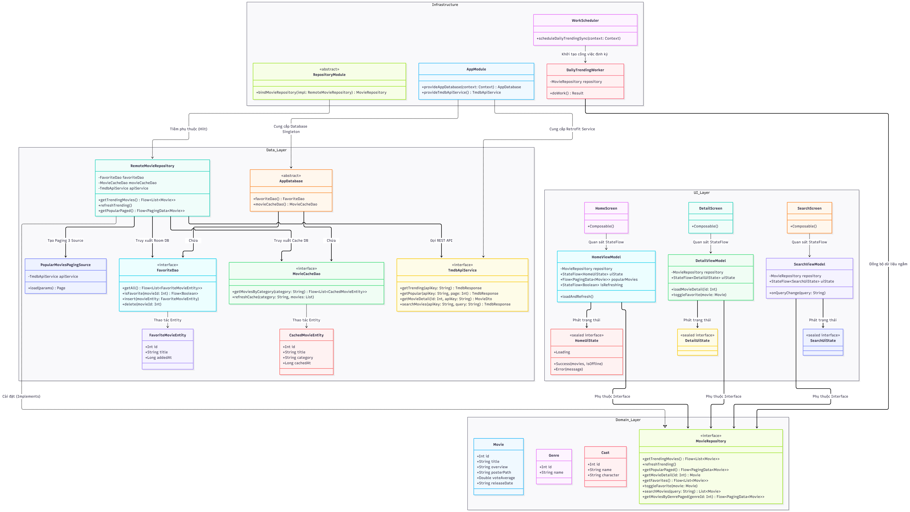

# CineTrack - Ứng Dụng Xem & Theo Dõi Phim Điện Ảnh

CineTrack là ứng dụng di động Android giúp tìm kiếm, theo dõi danh sách phim điện ảnh hot, 
khám phá phim theo thể loại, quản lý danh sách yêu thích và nhận thông báo đề xuất phim hằng ngày.


---

## 🌟 Danh sách tính năng chính

### 1. Trang Chủ (Home Screen)
- **Trending & Popular:** Hiển thị danh sách phim đang Hot (Trending) và Phim phổ biến (Popular) cuộn vô hạn bằng **Paging 3**.
- **Chế độ Offline (Single Source of Truth - SSOT):** Hiển thị dữ liệu từ Room Database khi mất kết nối mạng kèm Banner cảnh báo trạng thái mạng.
- **Tương tác nâng cao:**
  - **Pull-To-Refresh:** Vuốt từ trên xuống để làm mới dữ liệu.
  - **Scroll To Top:** Nút nổi nhảy ngay về đầu trang.
  - **Nút Refresh linh hoạt:** Bấm nút Trang chủ trên thanh BottomBar để làm mới dữ liệu với hiệu ứng xoay Icon 360°.

### 2. Chi Tiết Phim (Detail Screen)
- Thông tin chi tiết phim: Banner, điểm đánh giá, ngày phát hành, thể loại.
- **Danh sách Diễn viên (`credits`):** Cuộn ngang danh sách diễn viên với ảnh chân dung.
- **Danh sách Phim tương tự (`similar`):** Gợi ý các bộ phim có chủ đề tương tự.
- **Lưu/Xóa Yêu thích:** Lưu phim vào danh sách yêu thích với trạng thái đồng bộ thời gian thực.

### 3. Duyệt Phim Theo Thể Loại (Discover by Genre)
- Bấm vào bất kỳ Chip thể loại nào ở màn Chi tiết để mở ngay danh sách phim thuộc thể loại đó (`discover/movie`) hỗ trợ cuộn phân trang vô hạn.

### 4. Tìm Kiếm Phim (Search Screen)
- Tìm kiếm phim theo từ khóa với kỹ thuật **Debounce 300ms** giúp tiết kiệm tài nguyên mạng.

### 5. Quản Lý Yêu Thích (Favorites Screen)
- Xem danh sách các bộ phim đã lưu offline với khả năng tìm kiếm và xóa khỏi danh sách.

### 6. Cài Đặt & Thông Báo (Settings & WorkManager)
- **Lưu Preferences:** Tùy chỉnh chế độ Giao diện sáng/tối (Dark/Light Mode) lưu trữ bằng **DataStore Preferences**.
- **Thông báo nhắc phim hot:** Lên lịch thông báo định kỳ hằng ngày bằng **WorkManager (`@HiltWorker`)**.
- **Deep Link:** Bấm vào thông báo sẽ mở trực tiếp màn hình Chi tiết của bộ phim Hot nhất (`cinetrack://detail/{movieId}`).

---

## 🏗 Sơ Đồ Kiến Trúc Dự Án



## 🛠 Tech Stack & Thư Viện

- **Ngôn ngữ:** Kotlin 2.2.10
- **Giao diện (UI):** Jetpack Compose + Material3 + Navigation Compose
- **Dependency Injection:** Hilt 2.60.1 (`@HiltAndroidApp`, `@AndroidEntryPoint`, `@HiltViewModel`, `@HiltWorker`)
- **Lưu trữ dữ liệu:**
  - **Room Database 2.6.1:** Lưu trữ cache phim offline (SSOT) và danh sách yêu thích.
  - **DataStore Preferences 1.2.1:** Lưu cấu hình chế độ tối (Dark Theme) và trạng thái bật/tắt thông báo.
- **Phân trang:** Paging 3 (3.3.6)
- **Kết nối Mạng:** Retrofit 3.0.0 + OkHttp 5.5.0 + Kotlinx Serialization 1.11.0
- **Tải hình ảnh:** Coil Compose 2.7.0
- **Tác vụ ngầm:** WorkManager 2.9.1 + HiltWorker + Android Notifications + Deep Linking
- **Kiểm thử (Testing):** JUnit4, Kotlin Coroutines Test, Turbine, Compose UI Test (100% Passed)
- **Tối ưu hóa:** R8 Minification + ProGuard Rules (`isMinifyEnabled = true`, `isShrinkResources = true`)

---

## 🚀 Hướng Dẫn Build & Cài Đặt Dự Án

### 1. Yêu cầu hệ thống
- Android Studio Ladybug (hoặc mới hơn).
- JDK 17 / Java 17.
- Điện thoại/Máy ảo Android 7.0 (API 24) trở lên.

### 2. Các bước Cài đặt & Build

#### Bước 2.1: Clone Repository
```bash
git clone https://github.com/hghg-ai/cinetrack-journey.git
cd cinetrack-journey
```

#### Bước 2.2: Tự tạo file `local.properties` chứa TMDB API Key
Tạo một file có tên **`local.properties`** tại thư mục gốc của dự án (`D:/cinetrack-journey/local.properties`) và thêm dòng cấu hình sau:

```properties
# Vị trí SDK Android của bạn (nếu có)
sdk.dir=C\:\\Users\\USERNAME\\AppData\\Local\\Android\\Sdk

# TMDB API Key của bạn (Đăng ký miễn phí tại https://www.themoviedb.org/)
TMDB_API_KEY=bộ_khóa_api_tmdb
```

> **Lưu ý:** File `local.properties` đã được thêm vào `.gitignore` để bảo mật API Key cá nhân của bạn.

#### Bước 2.3: Chạy Kiểm thử (Unit Tests)
Mở cửa sổ Terminal trong Android Studio và chạy lệnh:
```bash
./gradlew test
```

#### Bước 2.4: Build file APK
- **Build bản Debug:**
  ```bash
  ./gradlew assembleDebug
  ```
- **Build bản Release (Đã bật R8 Minify & mã hóa ProGuard):**
  ```bash
  ./gradlew assembleRelease
  ```
  *File APK Release sẽ được lưu tại:* `app/build/outputs/apk/release/app-release-unsigned.apk`

Video Demo:
https://youtu.be/8JsfWjnVlH8

Điều tôi học dc:
Trong kotlin này, làm phần mobile thì gọi nhiều từ import, ko thể làm 1 dự án mà nhớ hết dc, mọi thứ
đều phải xây từ những cái nhỏ rồi ghép lại, từ app này thì bt rằng làm xong thì sẽ phải có kiểm thử,
giải quyết các bài toán thực tế của app:
Sửa lỗi cuộn trang bị nhảy về đầu khi Refresh.
◦
Sửa lỗi văng app khi nạp <adaptive-icon> vào Compose.
◦
Sửa lỗi đùn khoảng trống do cộng dồn innerPadding của Scaffold.
◦
Sửa lỗi che khuất nút bấm trên thanh điều hướng BottomBar.
Học dc thêm các kiến thức mới:
- Mô hình MVVM + UDF (Unidirectional Data Flow): luồng dữ liệu một
chiều (UI phát sự kiện ➔ ViewModel xử lý ➔ Cập nhật StateFlow ➔ UI vẽ lại), 
giúp giao diện tách biệt hoàn toàn với logic nghiệp vụ.
- Tư duy Offline-First với SSOT (Single Source of Truth): Hiểu bản chất việc 
lấy Room Database làm nguồn dữ liệu sự thật duy nhất. Màn hình luôn đọc dữ liệu từ Room DB 
trước (hiển thị lập tức 0ms), sau đó mới gọi API làm mới cache ngầm bên dưới.
- Jetpack Compose & Material 3: Thành thạo thiết kế UI khai báo (Declarative UI), 
quản lý trạng thái (remember, derivedStateOf, LaunchedEffect), xây dựng hiệu ứng 
xoay Icon 360°, Nút cuộn nổi Scroll To Top, Pull-To-Refresh.
- Hilt Dependency Injection: Hiểu cách quản lý và tiêm phụ thuộc tự động 
(@HiltAndroidApp, @AndroidEntryPoint, @HiltViewModel, @HiltWorker), giúp code cực kỳ 
linh hoạt và dễ nâng cấp.
- Paging 3: Làm chủ kỹ thuật cuộn phân trang vô hạn danh sách phim lớn từ Server mà không bị
giật lag bộ nhớ RAM.
- WorkManager + Deep Linking: Xử lý tác vụ ngầm định kỳ gửi Thông báo đẩy (Notification) 
và kích hoạt Deep Link (cinetrack://detail/{id}) mở thẳng vào màn hình chức năng.
- Quản lý Coroutines & Hủy tiến trình rác: Biết cách dùng refreshJob?.cancel() để hủy các 
luồng nạp cũ khi người dùng bấm spam nút Refresh liên tục, ngăn ngừa triệt để lỗi 
tràn bộ nhớ (OutOfMemory / App Crash).
- Kỹ thuật Debounce 300ms: Lọc bớt các yêu cầu mạng thừa khi người dùng gõ từ khóa tìm kiếm 
nhanh trên thanh Search.
- Tối ưu hóa R8 & ProGuard: Mã hóa code, nén ảnh/icon thừa 
(isMinifyEnabled = true, isShrinkResources = true), giảm dung lượng file APK/AAB tới 30%.

